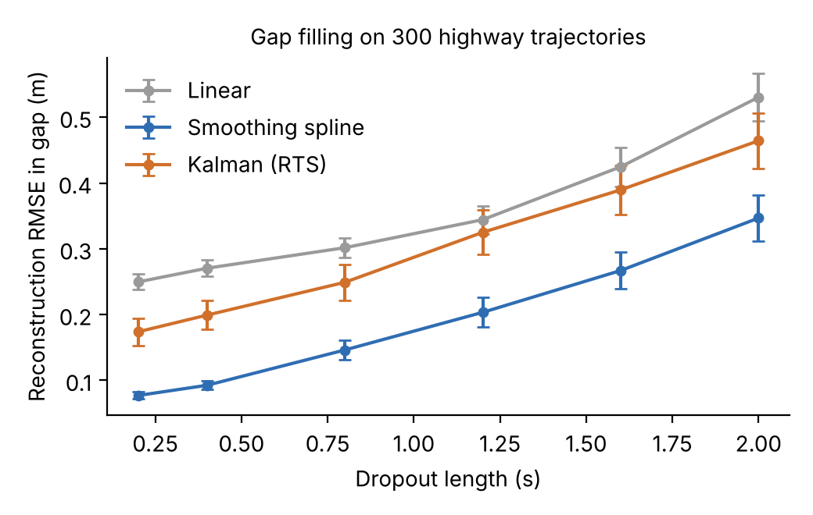
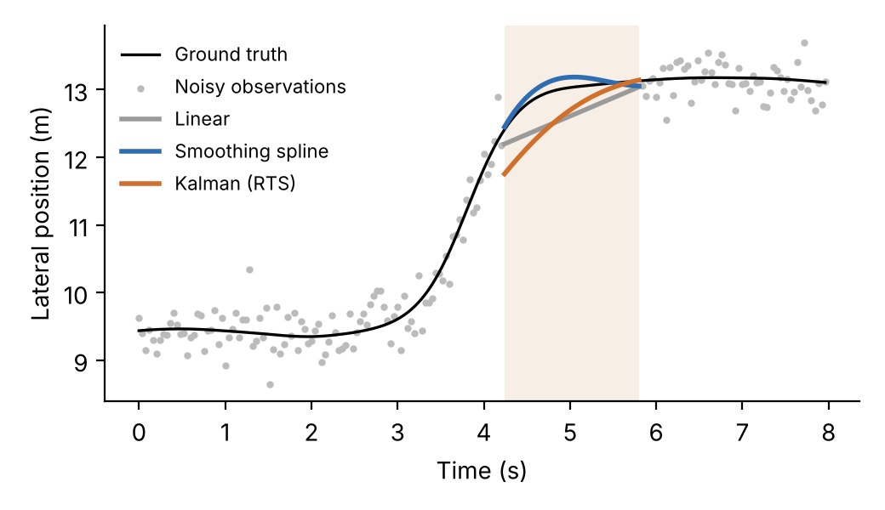
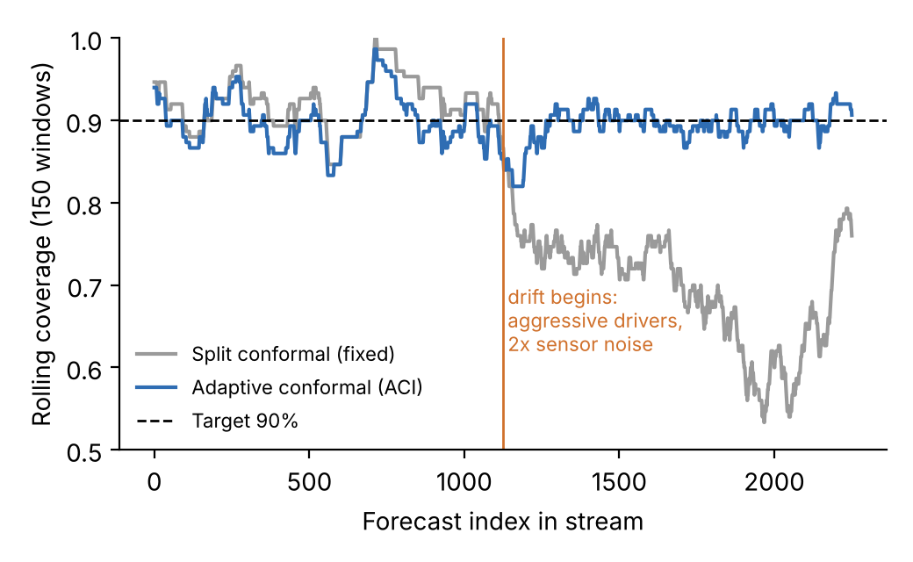

# av-trajectory-uq

Prototype for an MSc proposal on **uncertainty-aware reconstruction and forecasting of vehicle trajectories** for autonomous driving.

Two questions are tested end to end:

1. **Gap filling.** When a perception or localisation sensor drops out, how well can the missing part of a vehicle's trajectory be reconstructed? Compared: linear interpolation, cubic smoothing spline (smoothing chosen by generalised cross validation), and a constant-acceleration Kalman filter with RTS smoothing.
2. **Calibrated forecasting.** Predict a vehicle's position 3 s ahead from 2 s of noisy history, and attach a prediction region that holds its stated coverage. Compared: split conformal prediction and adaptive conformal inference (ACI) when driving behaviour and sensor noise drift.

## Data

The current runs use **synthetic** highway trajectories that copy the sampling rate (25 Hz) and lane geometry (3.75 m) of the highD dataset, with Gaussian measurement noise and injected dropouts. They exist so the full pipeline can be checked before real data is connected. The next step is to replace `src/data.py` with loaders for highD and nuScenes.

## Preliminary results

| Dropout length | Linear | Smoothing spline | Kalman (RTS, untuned) |
|---|---|---|---|
| 0.2 s | 0.250 m | **0.077 m** | 0.174 m |
| 0.8 s | 0.302 m | **0.146 m** | 0.249 m |
| 2.0 s | 0.530 m | **0.347 m** | 0.464 m |

RMSE inside the gap, mean over 300 trajectories.

* The Kalman smoother's nominal 95% band only covered **58 to 66%** of the true positions, because its noise model was not tuned. Model-based uncertainty is easy to get wrong, which motivates distribution-free calibration.
* 3 s forecast, 90% target: split conformal gave **92.3%** coverage on in-distribution data but fell to **70.1%** after drift (more aggressive drivers, doubled sensor noise). ACI held **89.7%**, at the cost of a wider region (10.5 m vs 6.6 m radius).
* A gradient-boosted residual model reduced final displacement error over constant velocity from 3.61 m to 3.17 m (in-distribution).





## Run

```bash
pip install -r requirements.txt
python src/run_experiments.py      # about 5 minutes on a laptop CPU
```

Outputs go to `results/results.json` and `figures/`.

## Layout

```
src/data.py             synthetic trajectories, noise, dropouts
src/gapfill.py          linear, smoothing spline, Kalman RTS
src/forecast.py         features, CV baseline, GBR residual model, split conformal, ACI
src/run_experiments.py  runs everything
```

## Author

Md. Shahinur Rahman Chowdhury, shahinur.rahman.ch@gmail.com
